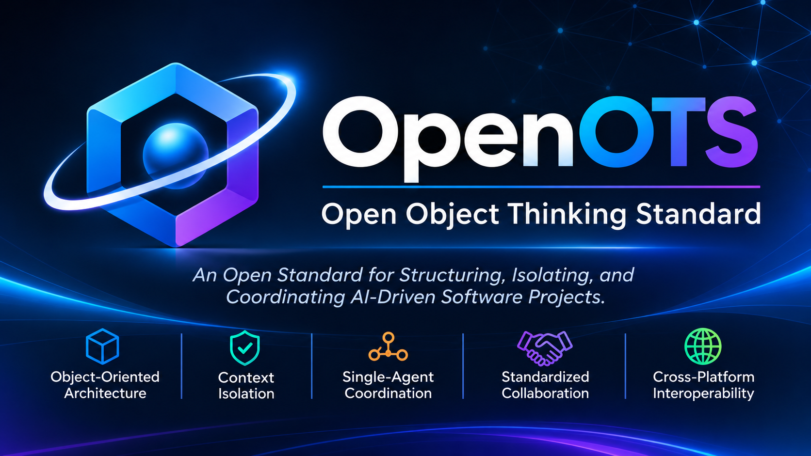
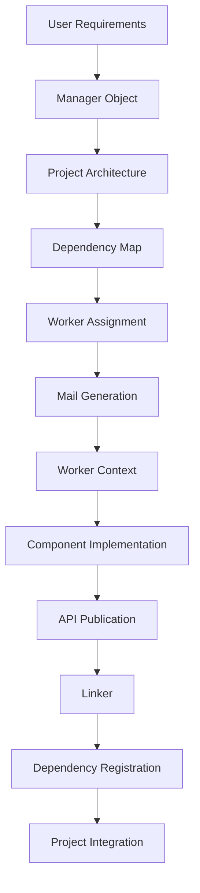

<p align="center">
  
</p>

<h1 align="center">OpenOTS</h1>

<h3 align="center">Open Object Thinking Standard</h3>

<p align="center">
  An Open Standard for Structuring, Isolating, and Coordinating AI-Driven Software Projects.
</p>

<p align="center">
  <a href="#specification-status">
    
  </a>
  <a href="#">
    
  </a>
  <a href="#core-architecture">
    
  </a>
  <a href="https://creativecommons.org/licenses/by/4.0/">
    
  </a>
</p>

---

Introduction

What if AI development environments could share a common architecture for building and managing software projects?

OpenOTS (Open Object Thinking Standard) is an open architectural standard designed to establish a unified structure for AI-driven software development.

It defines a standardized way to organize software projects into independent Objects, each with its own implementation workspace, execution context, communication channel, and public interfaces.

OpenOTS introduces a Single-Agent architecture in which one AI agent navigates between multiple independent Object contexts, coordinating their development without requiring multiple autonomous agents.

Rather than exposing an entire project to the AI at once, OpenOTS separates the project into manageable components with clearly defined responsibilities and interaction boundaries.

One Agent. Multiple Objects. Independent Contexts. Standardized Collaboration.

---

The Problem

AI-driven software development introduces a fundamental challenge: the AI must understand and manage increasingly large software projects while operating within limited context windows and execution environments.

When an AI works on an entire project within a single context, several problems can emerge:

- Context consumption caused by unrelated implementation details.
- Unnecessary exposure to other components' internal code.
- Difficulty maintaining clear component responsibilities.
- Increased complexity when managing dependencies.
- Interface changes that can break dependent components.
- Tight coupling between project organization and development environments.

OpenOTS addresses these challenges by introducing a standardized object-based architecture that separates implementation, context, communication, and interfaces.

---

Core Architecture

OpenOTS defines two fundamental Object roles.

1. Manager Object

The Manager Object is the central coordination unit of an OpenOTS project.

It is the only Object responsible for communicating with the user and managing the overall project architecture.

Its responsibilities include:

- Receiving and understanding user requirements.
- Defining the project architecture.
- Decomposing the project into independent software components.
- Creating and maintaining the Dependency Map.
- Defining Worker responsibilities.
- Assigning tasks to Worker Objects.
- Coordinating the overall development process.

2. Worker Object

A Worker Object is an independent development unit responsible for implementing a specific software component.

Its responsibilities include:

- Working within its designated context.
- Implementing its assigned component.
- Operating within its designated workspace.
- Publishing its public APIs through Linker.
- Registering dependencies on external APIs.
- Adapting its implementation when dependent interfaces change.

Each Worker maintains its own implementation and exposes functionality through documented public interfaces.

Single-Agent Architecture

OpenOTS uses a Single-Agent architecture.

All Objects operate through one AI agent that navigates between their respective contexts.

Objects represent independent architectural and execution scopes, not necessarily independent AI agents or processes.

When the AI transitions from the Manager context to a Worker context, the Worker receives its task through Mail rather than automatically inheriting the entire user conversation.

This allows the AI to focus on the current component while preserving a unified project architecture.

---

The Object Model

Every OpenOTS Object follows a unified structural model:

```text
Object/
│
├── Folder/
│
├── Context.txt
│
├── Mail/
│
└── Linker/
```

The four components define the fundamental structure of an Object.

Folder

The implementation workspace of the Object.

It contains the source code, resources, and implementation files belonging to that Object.

Implementation details should remain isolated from other Objects.

Context

The independent working context of the Object.

It is defined through a file named "Context.txt".

The context provides the AI with the information required to understand and implement the Object's responsibilities.

Each Object maintains its own context.

Mail

The communication mechanism between Object contexts.

Mail contains structured task documents and notifications directed to a specific Object.

When the AI transitions into a receiving Object's context, it reads the relevant Mail document to obtain the information required for its task.

Mail is also used by Dependency to notify Objects about changes to APIs they depend on.

Linker

The public interface registry of an Object.

It contains the APIs exposed by the Object and their corresponding documentation.

Linker allows other Objects to discover and use functionality without accessing the provider's internal implementation.

Linker follows a fundamental access rule:

Any Object Reading, Only Owner Writing.

- Any Object may read another Object's Linker.
- Only the owning Object may modify its Linker.

---

The Seven Core Principles

OpenOTS is founded on seven architectural principles.

01. Object-Oriented Thinking

A software project must be understood as a collection of independent software components.

Each component has:

- A clearly defined responsibility.
- Its own internal implementation complexity.
- A public API.
- Defined interaction boundaries.

Other components must interact with it through its declared interfaces.

02. Context Isolation

Every Object must maintain an independent working context.

The AI should operate within the context of the Object currently being developed.

A Worker should not require the internal implementation details or complete context of other Objects to perform its assigned task.

03. Isolated Folder

Every Object must have a designated implementation workspace.

The implementation files of one Object should remain isolated from those of other Objects.

Other Objects should access functionality through Linker rather than directly accessing internal implementation files.

Actual access restrictions must be enforced by the host development environment.

04. Manager / Worker Objects

An OpenOTS project must contain one Manager Object and may contain multiple Worker Objects.

The Manager coordinates the project and communicates with the user.

Workers independently implement their assigned components.

All Objects operate under the Single-Agent model.

05. Mail

Mail provides a standardized document-based communication mechanism between Object contexts.

The Manager creates task documents for Workers.

Workers read their incoming Mail within their own contexts.

Mail also carries Dependency notifications concerning API changes.

06. Linker

Every Object must expose its public APIs through Linker.

Linker contains API definitions and usage documentation.

Its access model is:

Any Object Reading, Only Owner Writing.

07. Dependency

Dependency maintains records of relationships between Objects and the APIs they consume.

When a provider changes an API, Dependency identifies affected consumers and generates notification Mail.

The consuming Workers are responsible for reviewing the updated interface and adapting their implementations.

---

Dependency Management

Dependency is responsible for maintaining API-level relationships between Objects.

Consider the following example:

```text
Worker_A ───── depends on ─────> Worker_B
                                     │
                                     └── Public API
```

Worker A consumes an API published by Worker B.

The interaction follows this sequence:

1. Worker B publishes its API through Linker.
2. Worker A reads the API documentation.
3. Worker A registers its dependency on that API.
4. Worker B modifies its API.
5. Worker B updates its Linker.
6. Dependency detects the relevant interface change.
7. Dependency generates notification Mail for Worker A.
8. Worker A reads the notification in its own context.
9. Worker A reviews the updated Linker.
10. Worker A adapts its implementation.

Responsibility Boundaries

API Provider:

- Owns and maintains its APIs.
- Updates its Linker.
- Documents interface changes.
- Does not modify consumer implementations.

Dependency:

- Records API dependencies.
- Detects relevant interface changes.
- Identifies affected consumers.
- Generates notification Mail.

API Consumer:

- Registers its dependencies.
- Reviews interface updates.
- Adapts its implementation when necessary.

OpenOTS defines this model without requiring multiple concurrent API versions.

The project is treated as a coordinated system in which affected consumers adapt to the updated interfaces.

---

Platform Interoperability

OpenOTS is designed to be independent of any specific AI development platform.

Its objective is to provide a common architectural structure that different AI Studios can interpret and implement.

An OpenOTS-compatible environment should support the ability to:

- Recognize Manager and Worker Objects.
- Interpret the standardized Object structure.
- Load independent Object contexts.
- Process Mail documents.
- Discover public APIs through Linker.
- Register and track API dependencies.
- Navigate between Object contexts.
- Respect Object implementation boundaries.

OpenOTS does not prescribe:

- A specific AI model.
- A specific programming language.
- A specific development platform.
- A specific AI Studio vendor.
- A specific implementation technology.

It defines the organizational and interaction conventions that compatible environments should implement.

Platform-Provided Isolation

OpenOTS relies on the isolation capabilities provided by the host AI development environment.

For example, an AI Studio may provide Trusted Folders or equivalent workspace-level access controls.

The host environment is responsible for enforcing actual file access restrictions.

OpenOTS defines the architectural boundaries that these capabilities must respect.

Logical Object separation and actual security isolation are distinct requirements.

A conforming implementation must not treat context instructions alone as a substitute for enforced workspace access restrictions.

---

Project Structure

An OpenOTS project consists of one Manager Object and multiple Worker Objects.

Example:

```text
MyProject/
│
├── Manager/
│   ├── Folder/
│   ├── Context.txt
│   ├── Mail/
│   └── Linker/
│
├── Worker_Auth/
│   ├── Folder/
│   ├── Context.txt
│   ├── Mail/
│   └── Linker/
│
├── Worker_Database/
│   ├── Folder/
│   ├── Context.txt
│   ├── Mail/
│   └── Linker/
│
├── Worker_API/
│   ├── Folder/
│   ├── Context.txt
│   ├── Mail/
│   └── Linker/
│
└── Dependency/
    └── DependencyMap/
```

The Dependency directory represents a possible project-level implementation of dependency management.

Its exact structure and serialization format are subject to further specification.

---

Execution Lifecycle

An OpenOTS project follows a structured development lifecycle.



Project Management

1. The AI starts within the Manager context.
2. The Manager receives user requirements.
3. The project is decomposed into independent components.
4. A Dependency Map is established.
5. Worker responsibilities are defined.

Component Development

1. The Manager prepares task Mail.
2. The AI transitions into the assigned Worker context.
3. The Worker reads its incoming Mail.
4. The AI operates within the Worker's designated Folder.
5. The component is implemented.
6. Public APIs are documented and published through Linker.

Component Interaction

1. A Worker discovers required APIs through other Objects' Linkers.
2. It registers dependencies on the consumed APIs.
3. It interacts with other components through their declared interfaces.

Interface Evolution

1. An API provider modifies its interface.
2. The provider updates its Linker.
3. Dependency identifies affected consumers.
4. Notification Mail is generated.
5. Consumers review the updated interface.
6. Consumers adapt their implementations.

---

Specification Status

OpenOTS is currently under development as an open technical standard.

The foundational architecture and seven core principles define the initial direction of the standard.

Further work is required to establish formal and interoperable specifications.

Planned specification areas include:

| Specification | Description |
| --- | --- |
| Object Model | Formal Object definitions and structural requirements. |
| Context Model | Context representation and loading conventions. |
| Mail Protocol | Standardized task and notification document formats. |
| Linker Protocol | API declaration and documentation formats. |
| Dependency Protocol | Dependency registration and interface change detection. |
| Execution Model | Object navigation and Single-Agent execution rules. |
| Security Model | Workspace isolation and access-control requirements. |
| Conformance Model | Requirements for platform compatibility and compliance. |

The long-term objective is to establish a platform-independent standard that can be implemented across different AI development environments.

---

Contributing

OpenOTS is intended to be an open and community-driven standard.

Technical discussions, architectural reviews, implementation proposals, and contributions are welcome.

Areas of contribution include:

- Core architectural definitions.
- Object structure and schemas.
- Mail document formats.
- Linker interface specifications.
- Dependency management.
- Security and isolation requirements.
- Reference implementations.
- Interoperability and conformance testing.

Contributions should aim to improve consistency, interoperability, and implementation clarity.

---

License

The OpenOTS specification, documentation, architectural definitions, and related written materials are licensed under the Creative Commons Attribution 4.0 International License (CC BY 4.0).

You are free to:

- Share: Copy and redistribute the material in any medium or format.
- Adapt: Remix, transform, and build upon the material.

Under the following terms:

- Attribution: Appropriate credit must be given, a link to the license must be provided, and changes must be indicated.

Read the full license:

"Creative Commons Attribution 4.0 International" (https://creativecommons.org/licenses/by/4.0/)

Software Implementations

Software implementations, reference implementations, SDKs, and development tools may be licensed separately under the Apache License 2.0.

Unless explicitly stated otherwise, CC BY 4.0 applies to the specification and documentation, not to software implementations.

---

OpenOTS

Open Object Thinking Standard

One Agent. Independent Objects. Standardized Collaboration.

An open architectural foundation for the next generation of AI-driven software development.
